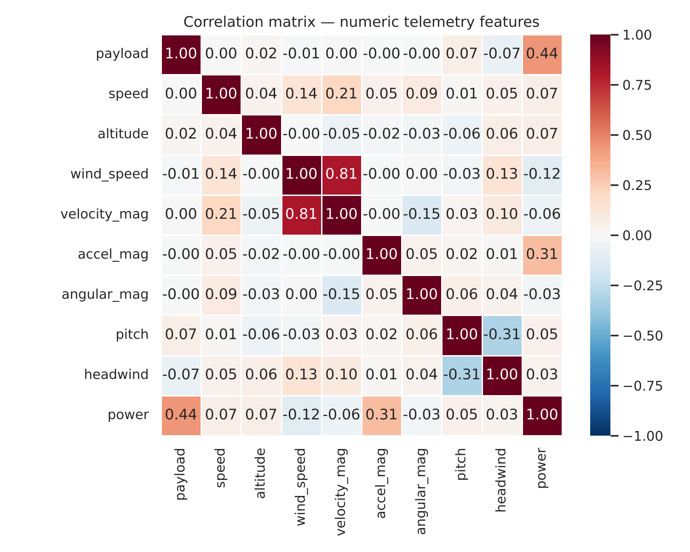
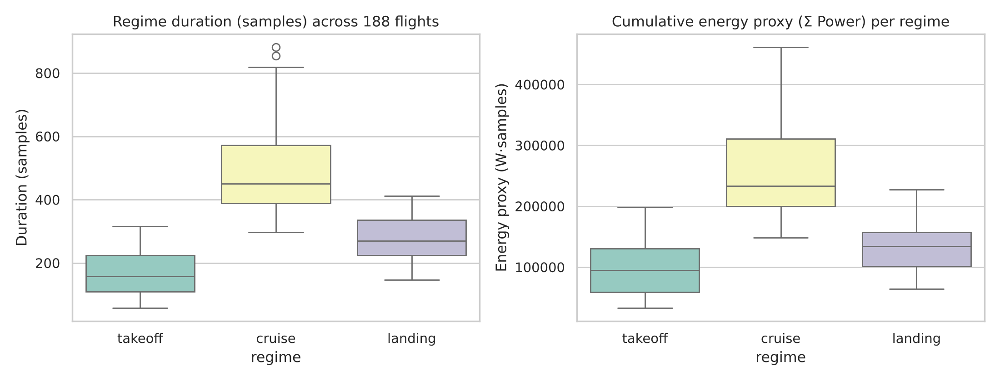
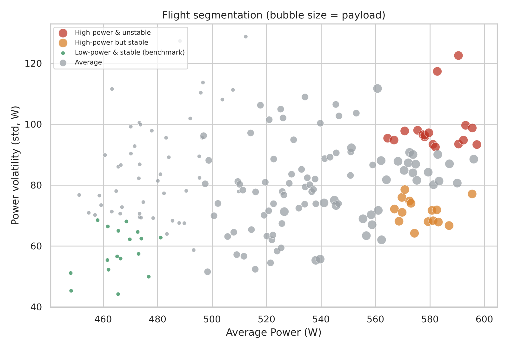

# UAV Flight Power: Exploratory Analysis with SQL (DuckDB)

> EDA and visualization contribution to **"Auditing Accuracy, Explanation Fidelity, and Robustness for Trustworthy UAV Power Prediction"** — accepted at IEEE ICTAI 2026.  
> Thu Le · Tung Le · **Pham Hoang Gia Phuc** · Vo Hong An · Phan Nguyen Thien Phuc  
> FPT University & University of Science, Ho Chi Minh City

---

**Question:** what drives the electrical power a UAV draws, and how does it change across takeoff, cruise and landing?

**Data:** public quadrotor flight telemetry (DJI Matrice 100; Rodrigues et al., *Scientific Data*, 2021): 188 flights, 177,464 samples. The data is not redistributed here; get it from the original source. `payload`, `speed` and `altitude` are mission setpoints fixed once per flight, not sensor readings.

**Method:** 10 analyses written as SQL (window functions, CTEs, conditional aggregation) on DuckDB, with matplotlib / seaborn charts. The insight text under each chart is written from the numbers in that cell's output.

**Main findings**
- Payload is the biggest driver of power: 0 to 500 g adds 96–107 W in every flight regime. Speed matters little, except cruise at 12 m/s (+29 W vs 4 m/s).
- Cruise lasts about twice as long as landing and three times as long as takeoff, so it accumulates the most energy even though takeoff draws more power per second.
- Flights keep their power rank across regimes mostly because payload is fixed per flight (Spearman 0.83–0.87); within flights of the same payload the rank correlation drops to 0.22–0.50.
- Wind effects depend on the regime: strong headwind during landing is the cheapest condition (−45 W vs same-payload average, 105 flights).

---

**Selected charts**

---

**Run it:** `pip install duckdb pandas seaborn matplotlib jupyter`, put the CSV at `real_data/flights_ready_for_eda.csv`, open `code/UAV_Analysis_sql.ipynb` and run all cells. There is no timestamp column, so row order within a flight is used as the time axis.
